<div align="center">

<picture>
  <source media="(prefers-color-scheme: dark)" srcset=".github/assets/banner-dark.svg">
  
</picture>

**Native 3D scenes without moving a render loop through PHP.**<br>
Render product previews, animated models and immersive scenes through Filament on Android and RealityKit on iOS.

[](https://packagist.org/packages/pushinbr/pam-native-3d)
[](https://github.com/push-in/pam-native-3d/releases/latest)

[](https://github.com/push-in/pam-native-3d/actions/workflows/ci.yml)
[](LICENSE)

[Install](#install) · [Quick example](#quick-example) · [Platforms](#platform-support) · [Requirements](#requirements) · [Docs](#docs) · [Issues](https://github.com/push-in/pam-native-3d/issues)

</div>

<a id="install"></a>
## <picture></picture> Install

Inside a PAM Native project, add only this capability:

```sh
pam composer require pushinbr/pam-native-3d
pam doctor --fix
```

New to PAM? Create a project with `pam init my-app --template native` (see the [PAM Native overview](https://push-in.github.io/pam-docs/native/overview/)), then come back here. Your application stays a normal Composer project with a committed lockfile.

<a id="quick-example"></a>
## <picture></picture> Quick example

```php
<?php

declare(strict_types=1);

use Pam\Native\ThreeD\Scene3D;
use Pam\Native\ThreeD\SceneAsset;

return Scene3D::make(new SceneAsset(
    androidGlb: 'models/robot.glb',
    iosUsdz: 'models/robot.usdz',
    animation: 0,
));
```

Assets are application-sandbox relative: GLB on Android and USDZ on iOS. Use an asset pipeline to generate both formats from one source model. `Scene3D::make()` also takes `SceneControlMode::None` or `Orbit` (default), a background color and a revision; `onEvent()` receives `SceneEventKind::Ready`, `AssetLoaded`, `Selected` or `Error`.

<a id="platform-support"></a>
## <picture></picture> Platform support

| Platform | Support | Notes |
| --- | --- | --- |
| Android | API 26+ | Google Filament 1.75.0 (filament, filament-utils, gltfio) |
| iOS | 15.0+ | RealityKit, Metal, QuartzCore |
| PAM Native | 0.8.0 to < 2.0.0 | From `pam-native.plugin.json`; PHP 8.5+ |

<a id="requirements"></a>
## <picture></picture> Requirements

The plugin declares no Android permissions and no iOS usage descriptions. Asset paths must be relative to the application sandbox: absolute paths, URLs and `..` segments are rejected with an `InvalidArgumentException`.

<a id="what-you-can-build"></a>
## <picture></picture> What you can build

- Interactive product and property previews
- Animated characters, education and data visualization
- High-fidelity 3D surfaces embedded in ordinary native screens

This package is independent from canvas, raw GPU shaders, AR, games and application templates. Render and animation loops remain native.

| | |
| --- | --- |
| **Native path** | Google Filament · RealityKit |
| **Application model** | Composer package + generated native integration |
| **Design rule** | Independent module; no feed, vertical or application template bundled |

<a id="licensing-notes"></a>
## <picture></picture> Licensing notes

Filament is Apache-2.0 licensed.

<a id="docs"></a>
## <picture></picture> Docs

- [PAM Native overview](https://push-in.github.io/pam-docs/native/overview/)
- [PAM introduction](https://push-in.github.io/pam-docs/introduction/)
- [Report an issue](https://github.com/push-in/pam-native-3d/issues)

<a id="pam-ecosystem"></a>
## <picture></picture> Part of the PAM ecosystem

PAM runs PHP natively on servers, desktops and phones. This repository is one piece of it.

| [**PAM**](https://github.com/push-in/pam) | [**PAM Desktop**](https://github.com/push-in/pam-desktop) | [**PAM Native**](https://github.com/push-in/pam-native) | [**Ecosystem**](https://github.com/push-in/pam#ecosystem) |
| --- | --- | --- | --- |
| the runtime and CLI | native desktop apps in PHP | native Android and iOS apps in PHP | every official package and plugin |

<sub>Docs: [push-in.github.io/pam-docs](https://push-in.github.io/pam-docs/introduction/) · [Issues](https://github.com/push-in/pam-native-3d/issues)</sub>

<p align="center"><sub><a href="LICENSE">Apache License 2.0</a> · Made in Brazil by Pushin</sub></p>
